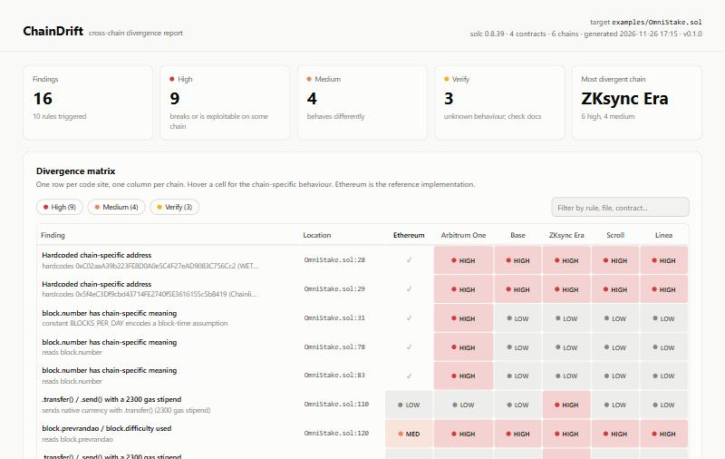

# ChainDrift

**A static analyzer that finds Solidity code that behaves differently on different EVM chains.**

You write a smart contract, test it on Ethereum, and deploy the same code to Arbitrum, Base, ZKsync, Scroll, Linea and
others. It compiles everywhere and the tests pass. But some lines now mean something different, and some of those
differences lose money. ChainDrift reads your contracts, finds those lines, and tells you, **chain by chain**, what
changes and how to fix it.



*The HTML report for [`examples/OmniStake.sol`](examples/OmniStake.sol): one row per risky line of code, one column per chain.
Open [`examples/OmniStake-report.html`](examples/OmniStake-report.html) in a browser to explore it, with hover tooltips and filters.*

---

## Contents

1. [The problem](#the-problem)
2. [What ChainDrift does](#what-chaindrift-does)
3. [Quick start](#quick-start)
4. [Usage](#usage)
5. [Walkthrough: scanning a real-looking contract](#walkthrough-scanning-a-real-looking-contract)
6. [Rules reference](#rules-reference)
7. [Supported chains](#supported-chains)
8. [How it works](#how-it-works)
9. [The knowledge base](#the-knowledge-base)
10. [Using it in CI](#using-it-in-ci)
11. [Testing](#testing)
12. [Limitations and roadmap](#limitations-and-roadmap)
13. [License](#license)

---

## The problem

Ethereum is the original EVM chain. Layer-2 rollups (Arbitrum, Optimism, Base, ZKsync, Scroll, Linea) and other EVM chains
(Polygon, BNB Chain, Avalanche) all run Solidity, so teams treat them as interchangeable. They are not:

| What you wrote | On Ethereum | Elsewhere |
|---|---|---|
| `block.number` | block height, one block every ~12s | **Arbitrum:** an *approximate Ethereum* block number, not Arbitrum's own. Other chains: blocks every 0.25–3s |
| `block.prevrandao` | a hard-to-predict random value | **Arbitrum:** always `1`. **ZKsync:** a constant. **Scroll:** `0`. **OP Stack:** known in advance |
| `payable(x).transfer(v)` | forwards 2300 gas | **ZKsync:** often not enough gas. This bug class reportedly locked ~921 ETH in the Gemholic sale (2023) |
| `keccak256(0xff ++ deployer ++ salt ++ codehash)` | the CREATE2 address | **ZKsync:** wrong, because ZKsync derives addresses differently |
| `address(0x100).staticcall(...)` (passkey signatures) | supported since the Fusaka upgrade | missing on some chains, and **the call returns success with no data** instead of failing |
| `0xC02a...6Cc2` | WETH | a different contract, or none at all |
| `tx.origin == msg.sender` ("humans only") | broken by EIP-7702 | broken by EIP-7702 or native account abstraction |

None of these cause compiler errors or warnings, and most of them pass unit tests run against a local Ethereum-like node.
Today you find them by reading each chain's "differences from Ethereum" page by hand, for every chain, every time.

## What ChainDrift does

1. **Compiles** your Solidity with the real compiler (`solc`) through [Slither](https://github.com/crytic/slither),
   Trail of Bits' analysis framework.
2. **Runs 13 detection rules** over Slither's intermediate representation (SlithIR) *and* over the compiled bytecode.
   Inline assembly is covered too.
3. **Assesses every finding per chain** using a curated, confidence-rated knowledge base of 10 chains.
4. **Reports** as terminal text, JSON, SARIF (GitHub code scanning) or a self-contained HTML page.

Each finding tells you the line, what was found, how each chain treats it (with severity, a note and a confidence
level), which chains are unaffected, and how to fix it.

## Quick start

**Requirements:** Python 3.11+ and a Solidity compiler (installed through `solc-select`, below).

```bash
git clone <this repo> && cd chaindrift
python -m venv .venv
# Windows: .venv\Scripts\activate      macOS/Linux: source .venv/bin/activate
pip install -e ".[dev]"                     # ChainDrift + Slither + pytest
solc-select install 0.8.28 && solc-select use 0.8.28

python -m chaindrift scan examples/OmniStake.sol
python -m chaindrift scan examples/OmniStake.sol -o report.html    # then open report.html
```

`chaindrift` and `python -m chaindrift` are the same program. Use the second form if your OS blocks the generated
`chaindrift.exe` launcher, as Windows Smart App Control sometimes does.

## Usage

```text
chaindrift scan TARGET [options]     analyse a .sol file, a folder of .sol files, or a Foundry/Hardhat project
chaindrift chains                    list the chains in the knowledge base
chaindrift rules                     list the detection rules
chaindrift --version
```

| Option | Meaning |
|---|---|
| `--chains ethereum,arbitrum,zksync` | only assess these chains (default: all 10) |
| `--rules prevrandao,transfer-send` | only run these rules (default: all 13) |
| `-o FILE` | write the report to a file; the format comes from the extension (`.html`, `.json`, `.sarif`, anything else is text) |
| `--format text\|json\|html\|sarif` | force a format |
| `--min-severity low` | hide findings below this severity |
| `--fail-on high` | exit with code 1 if any finding reaches this severity (for CI) |
| `--solc PATH` | use this compiler binary (otherwise: `$CHAINDRIFT_SOLC`, then the newest solc-select install, then `solc` on PATH) |
| `--solc-args "--evm-version paris"` | extra compiler arguments |
| `--include-deps` | also report findings inside dependencies (`lib/`, `node_modules/`) |

**Targets.** Pass a single `.sol` file, a folder (every `.sol` file is compiled; `lib/`, `node_modules/`, `out/`,
`cache/` and similar folders are skipped), or a Foundry/Hardhat project root (detected by `foundry.toml` or
`hardhat.config.*` and compiled by that framework).

**Exit codes.**

| Code | Meaning |
|---|---|
| `0` | analysis finished; nothing reached `--fail-on` |
| `1` | at least one finding reached `--fail-on` |
| `2` | something could not be analysed (target missing, no `.sol` files, compile error, unknown chain or rule) |

A compile error always exits with `2`, even if other files were scanned, so a broken file can never make CI pass silently.

**Severities.** These are ordered from most to least urgent:

| Severity | Meaning |
|---|---|
| `high` | breaks or is exploitable on that chain |
| `medium` | behaves differently in a way that probably matters |
| `check` | **unknown**: the knowledge base can't confirm the chain's behaviour, so verify before deploying |
| `low` | differs, but is usually harmless or already bad practice everywhere |
| `info` | worth knowing (for example, code that branches on chain id) |
| `none` | same as Ethereum (not shown as a finding) |

A finding's overall severity is the worst severity across the chains you selected. If you select only chains where
the code behaves like Ethereum, the finding disappears.

## Walkthrough: scanning a real-looking contract

[`examples/OmniStake.sol`](examples/OmniStake.sol) is a staking vault with a weekly raffle, gasless "unstake by
signature", passkey login and per-user sub-accounts. Everything in it works on Ethereum. Scanning it for six chains
gives **16 findings: 9 high, 4 medium, 3 check**:

```bash
python -m chaindrift scan examples/OmniStake.sol --chains ethereum,arbitrum,base,zksync,scroll,linea
```

| Line | Code | What goes wrong |
|---|---|---|
| 28–29 | hardcoded WETH and Chainlink ETH/USD addresses | these are Ethereum-mainnet contracts; on other chains the calls revert, or hit nothing |
| 31, 78, 83 | rewards computed from `block.number` and `BLOCKS_PER_DAY = 7200` | rewards accrue ~6x faster on Base and Linea (2s blocks), ~12x on ZKsync, and follow L1 blocks on Arbitrum |
| 110, 124 | `.transfer()` payouts | can run out of gas on ZKsync, so funds get stuck |
| 120 | raffle winner from `block.prevrandao` | constant on Arbitrum and ZKsync, 0 on Scroll, so the winner is predictable |
| 136, 143 | precomputed sub-account addresses with CREATE2 | wrong on ZKsync, so `createSubAccount()` always reverts there |
| 48 | `onlyHumans` uses `tx.origin == msg.sender` | bypassable with EIP-7702 on Ethereum and Base, and with native account abstraction on ZKsync |
| 64 | EIP-712 domain separator cached in the constructor | after a chain split, signatures are valid on both forks |
| 109 | relayer refund `80_000 * tx.gasprice` | ignores the rollup's L1 data fee, so relayers lose money |
| 129 | P-256 passkey verification at `0x100` | not confirmed on Scroll and Linea; if it's missing, every check quietly returns false |
| 18, 26 | compiled bytecode uses `PUSH0`, `TLOAD`, `TSTORE`, `MCOPY` | confirm Linea supports these opcodes, or compile for an older EVM version |

Here's an excerpt of the terminal output:

```text
[HIGH] block.prevrandao / block.difficulty used  (prevrandao)
  OmniStake.sol:120  in OmniStake.drawRaffle()
  > uint256 winner = uint256(keccak256(abi.encode(block.prevrandao, raffleEntrants.length)))
  reads block.prevrandao
    HIGH  Arbitrum One
        block.prevrandao / block.difficulty always returns the constant 1.
    HIGH  Base
        OP Stack: returns the RANDAO of the L1 origin block, which is public before the L2 block is built.
    HIGH  ZKsync Era
        Returns a fixed constant (2500000000000000), not randomness.
    HIGH  Scroll
        Returns 0 (Scroll does not expose a RANDAO value).
    MEDIUM  Ethereum
        RANDAO output: unpredictable far ahead, but the block proposer can bias it by withholding a block.
  fix: Use a verifiable randomness oracle (e.g. a VRF) or a commit-reveal scheme.
```

## Rules reference

| Rule | Detects | Why it diverges | Worst case |
|---|---|---|---|
| `block-number` | `block.number`, Yul `number()`, constants named like `BLOCKS_PER_YEAR` | block times range from 0.25s to 12s; Arbitrum returns an L1 block number | **high** (Arbitrum) |
| `prevrandao` | `block.prevrandao`, `block.difficulty`, Yul `prevrandao()` | only Ethereum has a RANDAO beacon; L2s return constants or values known in advance | **high** (all L2s) |
| `transfer-send` | `.transfer()`, `.send()` | 2300 gas is not enough on ZKsync, or for smart-wallet recipients anywhere | **high** (ZKsync) |
| `create2-address` | `keccak256(0xff ++ ...)` address maths, Yul `create`/`create2`, `new C{salt: s}()` | ZKsync uses a different address formula and needs bytecode known at compile time | **high** (ZKsync) |
| `selfdestruct` | `selfdestruct(...)` | changed by EIP-6780; rejected on ZKsync and disabled on Scroll | **high** (ZKsync, Scroll) |
| `hardcoded-gas` | `call{gas: N}`, `f{gas: N}()`, Yul `call(N, ...)`, `gasleft() < N` | gas schedules differ (L1 data costs on Arbitrum, pubdata on ZKsync) | **high** (ZKsync) |
| `gas-price` | `tx.gasprice`, `block.basefee`, and their Yul forms | rollups charge a separate L1 data fee that these values leave out | medium |
| `eoa-check` | `tx.origin == msg.sender`, `code.length == 0`, `extcodesize`, `isContract()` | EIP-7702 gives EOAs code; ZKsync has native account abstraction | medium |
| `chainid-replay` | EIP-712 domains with no `chainId`, a hardcoded one, or one cached and never re-checked | signatures become valid on other chains or forks | **high** |
| `chain-gated-logic` | `block.chainid == <literal>` | code paths that only run on some chains | info |
| `precompile` | calls to 0x01–0x11 and 0x100 (Solidity builtins, `address(0x..)` calls, Yul) | precompile sets differ, and a missing one *returns success with empty data* | **high** (e.g. ripemd160, blake2f on ZKsync and Scroll) |
| `known-address` | WETH, USDC, USDT, Chainlink feeds, Uniswap, Multicall3, Permit2, the CREATE2 factory, OP Stack predeploys, Arbitrum precompiles, ZKsync system contracts | the same address holds something else, or nothing, on other chains | **high** |
| `opcode-support` | `PUSH0`, `TLOAD`, `TSTORE`, `MCOPY`, `BLOBHASH`, `BLOBBASEFEE`, `CLZ` in the **compiled bytecode** | newer compilers emit new opcodes by default, and lagging chains may not support them | medium / check |

### Things it deliberately does *not* flag

The rules are written to skip common look-alikes. The test suite enforces each of these:

- `address(this).code.length == 0`, the standard "am I still in my constructor?" check, is not an EOA check.
- `address(0x1)` used as a sentinel value (as in Safe's owner list) is not a call to the ecrecover precompile, because only constants that are *called* count.
- OpenZeppelin-style EIP-712, which re-checks `block.chainid` at signing time, is correct and not reported.
- `block.timestamp`-based logic and `call{value: x}("")` transfers are portable.
- `ecrecover`, `sha256` and `keccak256` are available everywhere.

## Supported chains

| id | Chain | Type | Block time |
|---|---|---|---|
| `ethereum` | Ethereum | L1 (the reference) | 12s |
| `arbitrum` | Arbitrum One | optimistic rollup (Nitro) | 0.25s |
| `optimism` | OP Mainnet | optimistic rollup (OP Stack) | 2s |
| `base` | Base | optimistic rollup (OP Stack) | 2s |
| `zksync` | ZKsync Era | ZK rollup (EraVM) | ~1s |
| `scroll` | Scroll | ZK rollup (zkEVM) | ~3s |
| `linea` | Linea | ZK rollup (zkEVM) | ~2s |
| `polygon` | Polygon PoS | PoS sidechain | ~2s |
| `bsc` | BNB Smart Chain | PoSA L1 | ~0.75s |
| `avalanche` | Avalanche C-Chain | L1 | ~2s |

Adding a chain means adding a TOML entry. No code changes are needed (see [The knowledge base](#the-knowledge-base)).

## How it works

```
 .sol file / folder / Foundry or Hardhat project
          |
          v
   crytic-compile + solc ---------------> compiled bytecode (init + runtime)
          |                                        |
          v                                        |
   Slither: AST -> SlithIR                         |
   (Solidity AND inline assembly                   |
    lowered into one IR)                           |
          |                                        |
          v                                        v
   12 IR rules ----------------------------> opcode rule
          |                                        |
          +--------------> Sites <-----------------+
                 chain-independent facts: "line 120 reads block.prevrandao"
                           |
                           v
        Knowledge base (TOML): Site x Chain -> Assessment
                 severity + confidence + chain-specific note
                           |
                           v
        Findings -> text | JSON | SARIF | HTML
```

**Design decisions that matter:**

- **Detection is separate from assessment.** A rule answers only "where does this construct appear?" The knowledge base
  answers "what does each chain do with it?" Chains upgrade every few months, so the volatile part lives in plain data
  anyone can update, and the code stays stable.
- **One IR for Solidity and assembly.** Slither lowers `block.number` and Yul `number()` into the same IR, so each rule
  handles both with almost no extra code.
- **Constant tracking.** A small tracker follows compile-time values through type conversions and `constant` state
  variables. That's how `IArbSys(address(100)).arbBlockNumber()` is recognised as a call to Arbitrum's `ArbSys`
  precompile, and how a `SENTINEL = address(0x1)` that is never called is ignored.
- **Bytecode, not just source.** The opcode rule walks the compiled bytecode, skipping PUSH data and stripping solc's
  metadata trailer. That catches opcodes the *compiler* chose to emit, which no source-level tool can see.
- **"Unknown" is a first-class answer.** If the knowledge base isn't sure, the severity is `check`, never a guess.

### Project layout

```
chaindrift/
  cli.py                 command-line interface, exit codes
  engine.py              compile targets, run rules, assess per chain, de-duplicate, sort
  context.py             one compiled project: iteration helpers, Site construction, bytecode access
  ir.py                  SlithIR helpers: constant tracker, Yul call names
  models.py              Site, Assessment, Finding, severity ordering
  solc.py                find a solc binary (flag, env var, solc-select, PATH)
  rules/
    base.py              Rule base class
    environment.py       block-number, prevrandao, gas-price, chain-gated-logic, eoa-check
    execution.py         transfer-send, hardcoded-gas, create2-address, selfdestruct, opcode-support
    addresses.py         precompile, known-address
    signatures.py        chainid-replay
  knowledge/
    chains.toml          the 10 chains
    divergences.toml     per-rule, per-chain behaviour
    precompiles.toml     precompile availability per chain
    addresses.toml       well-known chain-specific addresses
    opcodes.toml         recent opcodes and chain support
  report/                text.py, jsonout.py, sarif.py, html.py, common.py
tests/
  contracts/             one fixture per rule + Clean.sol (negative control)
  test_rules.py          per-rule end-to-end tests
  test_knowledge_and_reports.py
  test_cli_and_errors.py
examples/                OmniStake.sol demo + its HTML report
docs/                    screenshot + LEARNING_GUIDE.md
```

## The knowledge base

The files in `chaindrift/knowledge/` are the heart of the project. An entry looks like this:

```toml
[rules.prevrandao.chains]
arbitrum = { severity = "high", confidence = "high", note = "block.prevrandao / block.difficulty always returns the constant 1." }
```

Lookups go from most to least specific: `variant + chain`, then `variant default`, then `rule + chain`, then
`rule default`. Notes can use `{chain}` and `{block_time_s}`, which are filled in per chain. The loader validates
everything at startup (unknown chains, invalid severities, missing titles) so a typo fails loudly instead of quietly
producing wrong results.

**Confidence levels.** Every chain-specific claim is marked `high`, `medium` or `low`. The data reflects public
documentation as of mid-2026. Chains upgrade often, so verify `medium` and `low` entries against the chain's own
docs (linked in `chains.toml`) before relying on them.

**Contributing a fact.** Edit the TOML, set `confidence`, add a documentation link to `references` or `docs`, and run
`pytest`.

## Using it in CI

```yaml
# .github/workflows/chaindrift.yml (excerpt)
permissions:
  security-events: write
steps:
  - uses: actions/checkout@v4
  - uses: actions/setup-python@v5
    with: { python-version: "3.12" }
  - run: |
      pip install "git+https://github.com/<your-user>/chaindrift"
      solc-select install 0.8.28 && solc-select use 0.8.28
  - run: chaindrift scan . --chains ethereum,arbitrum,base -o chaindrift.sarif --fail-on high
  - uses: github/codeql-action/upload-sarif@v3
    if: always()
    with: { sarif_file: chaindrift.sarif, category: chaindrift }
```

Findings then show up as code-scanning alerts on the affected lines of a pull request. This repository's own
workflow (`.github/workflows/ci.yml`) runs the test suite and uploads the demo scan this way.

## Testing

```bash
python -m pytest -q         # 44 tests, about 3 seconds
```

| File | Covers |
|---|---|
| `test_rules.py` | each rule compiled and analysed end to end against its fixture contract, with exact counts, variants and per-chain severities; the `Clean.sol` negative control; chain selection; `--min-severity`; folder scans |
| `test_knowledge_and_reports.py` | knowledge-base integrity, the bytecode scanner (PUSH data, metadata), all four reporters, HTML escaping of contract strings, CLI listing and `--fail-on` |
| `test_cli_and_errors.py` | missing targets, empty folders, unknown rules, broken contracts, partial failures (exit code 2), dependency folders skipped, `--evm-version` changing opcode findings, solc lookup order, format inference from `-o`, SARIF levels, knowledge-base validation, lookup precedence, grouping of chain notes |

The tests compile real Solidity with real `solc`; nothing is mocked. Several tests in `test_cli_and_errors.py` exist
because an end-to-end run of the CLI found that a missing target, an empty folder or a broken contract could exit
with `0`. Those now exit with `2`.

## Limitations and roadmap

**Limitations:**
- **Static analysis.** ChainDrift reports *where* behaviour can differ. Whether that matters depends on how the value is used.
- **Knowledge base snapshot.** It was reviewed mid-2026. Treat `medium`/`low` confidence notes as "verify".
- **Intra-procedural constant tracking.** An address passed as a function argument or set in an initializer is not followed.
  That's also the recommended design (configure addresses per deployment), so it's not flagged.
- **ZKsync coverage** models EVM-level differences, not every `zksolc` compilation constraint.
- **Linear bytecode scan.** Data embedded after code, which is rare in solc output, could cause an `opcode-support` false positive.

**Roadmap ideas:**
- Scan deployed contracts by address (fetch verified source from block explorers).
- More chains (zkSync-stack chains, Mantle, Blast, Celo, Gnosis) and more address tables (official USDC per chain).
- Rules for L2 sequencer-uptime checks on oracles, and for cross-chain messaging assumptions.
- A `--diff` mode: "what changes if I add chain X to my deployment list?"

## License

AGPL-3.0, the same license as [Slither](https://github.com/crytic/slither), which ChainDrift builds on.
